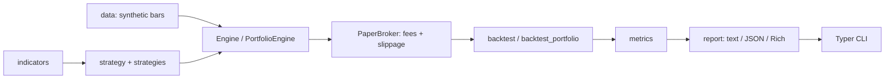

<div align="center">


# Trading Bot Framework

**A broker-agnostic, batteries-included Python framework for writing, backtesting, and scaling trading strategies.**

_Built and maintained by **Viprasol Tech**._

[](https://github.com/Viprasol-Tech/trading-bot-framework/actions/workflows/ci.yml)
[](https://www.python.org/)
[](LICENSE)
[](CHANGELOG.md)
[](pyproject.toml)
[](https://docs.astral.sh/ruff/)
[](tests/)

</div>

---

## Overview

Trading Bot Framework is a small, dependency-light core for building algorithmic
trading systems. A **strategy** is pure decision logic that reads a per-bar
**context** and returns orders; an **engine** runs it against a **broker**. The
same strategy code works for a single symbol, a multi-symbol portfolio, and a
deterministic offline backtest — no API keys, no network, no surprises.

## Features

- 📈 **Four built-in strategies** — SMA crossover, RSI mean-reversion, Donchian breakout, and Bollinger mean-reversion.
- 🧮 **Pure-Python indicators** — SMA, EMA, Wilder RSI, rolling max/min, and standard deviation, all warm-up aware.
- 💰 **Realistic fills** — proportional fees *and* slippage that always works against the trader.
- 🧺 **Multi-symbol portfolio engine** — run many strategy/symbol pairs over one shared capital pool in lock-step.
- 📊 **Full metrics suite** — total return, CAGR, volatility, Sharpe, Sortino, max drawdown, and Calmar.
- 🧾 **Backtest reports** — render as plain text, a JSON dict, or a polished Rich table.
- 🖥️ **Ergonomic CLI** — `version`, `strategies`, `demo`, `backtest`, and `portfolio` subcommands.
- 🧪 **Typed & tested** — `mypy --strict` clean, ruff-linted, with 85 unit tests.

## Quickstart

```bash
# Clone and install (editable, with dev extras)
git clone https://github.com/Viprasol-Tech/trading-bot-framework.git
cd trading-bot-framework
pip install -e ".[dev]"

# Explore from the terminal
trading-bot-framework strategies
trading-bot-framework demo
trading-bot-framework backtest --strategy rsi --bars 250
trading-bot-framework portfolio --fee-rate 0.001 --slippage-rate 0.0005 --json
```

## Usage

### Backtest a single strategy

```python
from trading_bot_framework.backtest import backtest
from trading_bot_framework.data import sine_bars
from trading_bot_framework.report import build_report
from trading_bot_framework.strategies import RsiStrategy

bars = sine_bars(n=250, symbol="ACME")
result = backtest(
    RsiStrategy(period=14, lower=30, upper=70, quantity=10),
    bars,
    starting_cash=10_000.0,
    fee_rate=0.001,
    slippage_rate=0.0005,
)

report = build_report(result.equity_curve, result.num_fills)
print(report.render_text())
print("Sharpe:", round(report.sharpe, 2))
```

### Run a multi-symbol portfolio

```python
from trading_bot_framework.data import sine_bars
from trading_bot_framework.portfolio import Allocation, backtest_portfolio
from trading_bot_framework.strategies import RsiStrategy, SmaCrossStrategy

allocations = [
    Allocation("AAA", SmaCrossStrategy(quantity=5), sine_bars(n=250, symbol="AAA")),
    Allocation("BBB", RsiStrategy(quantity=5), sine_bars(n=250, symbol="BBB")),
]

result = backtest_portfolio(allocations, starting_cash=20_000.0, fee_rate=0.001)
print(f"Final equity: ${result.final_equity:,.2f}")
print("Fills by symbol:", result.fills_by_symbol)
```

### Write your own strategy

```python
from trading_bot_framework.indicators import ema
from trading_bot_framework.models import Order
from trading_bot_framework.strategy import Context, Strategy


class EmaThrust(Strategy):
    name = "ema_thrust"

    def on_bar(self, ctx: Context) -> list[Order]:
        fast = ema(ctx.closes(), 8)
        slow = ema(ctx.closes(), 21)
        if fast is None or slow is None:
            return []
        if fast > slow and ctx.position == 0.0:
            return [ctx.buy(1.0)]
        if fast < slow and ctx.position > 0.0:
            return [ctx.sell(ctx.position)]
        return []
```

## Architecture



## Module & feature reference

| Module | Highlights |
| --- | --- |
| `models` | `Bar`, `Order`, `Fill`, `Side` — frozen, slotted dataclasses. |
| `broker` | `Broker` interface and multi-symbol `PaperBroker` with fees + slippage. |
| `strategy` | `Strategy` base class and the per-bar `Context` helpers. |
| `strategies` | `SmaCrossStrategy`, `RsiStrategy`, `BreakoutStrategy`, `MeanReversionStrategy`. |
| `indicators` | `sma`, `ema`, `rsi`, `rolling_max`, `rolling_min`, `stddev`. |
| `engine` | `Engine` — single strategy, single symbol. |
| `portfolio` | `PortfolioEngine`, `Allocation`, `backtest_portfolio`. |
| `backtest` | `backtest`, `BacktestResult` (equity curve + summary). |
| `metrics` | total return, CAGR, volatility, Sharpe, Sortino, max drawdown, Calmar. |
| `report` | `BacktestReport`, `build_report` — text / JSON / Rich rendering. |
| `data` | `sine_bars`, seeded `random_walk_bars`. |
| `cli` | `version`, `strategies`, `demo`, `backtest`, `portfolio`. |

## Roadmap

- [x] Multiple built-in strategies (SMA, RSI, breakout, mean-reversion)
- [x] Multi-symbol portfolio engine
- [x] Fees and slippage modelling
- [x] Metrics module (Sharpe, drawdown, CAGR, Sortino, Calmar)
- [x] Backtest report (text / JSON / Rich)
- [x] CLI subcommands
- [ ] CSV / Parquet historical data loaders
- [ ] Short selling and leverage in the paper broker
- [ ] Live broker adapters (ccxt, Alpaca)
- [ ] Walk-forward and parameter-sweep optimisation

## FAQ

**Does it need an exchange account or API keys?**
No. Everything runs offline against `PaperBroker` and synthetic data. Live
adapters are on the roadmap.

**Can one strategy trade several symbols?**
Yes — bind it per symbol with `Allocation` and run `PortfolioEngine`; all
allocations share one cash pool, fees, and slippage.

**Why no NumPy/pandas dependency?**
The core is deliberately pure-Python so it stays fast to import, trivial to
test, and deterministic. You can still use them in your own strategies.

## Contributing

Contributions are welcome! Please open an issue to discuss substantial changes
first. Before submitting a pull request, make sure the full check suite passes:

```bash
ruff check .
ruff format .
mypy src
pytest -q
```

See [CONTRIBUTING.md](CONTRIBUTING.md) and our
[Code of Conduct](CODE_OF_CONDUCT.md) for details.

## Contact — Viprasol Tech Private Limited

- Website: [viprasol.com](https://viprasol.com)
- Email: [support@viprasol.com](mailto:support@viprasol.com)
- Telegram: [t.me/viprasol_help](https://t.me/viprasol_help) | WhatsApp: +91 96336 52112
- GitHub: [@Viprasol-Tech](https://github.com/Viprasol-Tech) | [LinkedIn](https://www.linkedin.com/in/viprasol/) | X [@viprasol](https://twitter.com/viprasol)

## License

[MIT](LICENSE) (c) 2025 Viprasol Tech Private Limited
