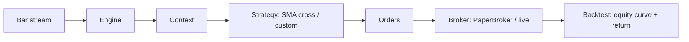

<p align="center">
  
</p>

<h1 align="center">Trading Bot Framework</h1>

<p align="center">
  <strong>Generic, broker-agnostic strategy-runner framework with built-in backtesting — in Python.</strong><br>
  Write a strategy once as <code>on_bar(ctx) -&gt; orders</code>; run it against a paper broker, backtest it, then swap in a live broker.
</p>

<p align="center">
  <em>Built and maintained by <a href="https://viprasol.com">Viprasol Tech</a> — Fintech Experts. Full-Stack Builders.</em>
</p>

<p align="center">
  <a href="https://github.com/Viprasol-Tech/trading-bot-framework/actions/workflows/ci.yml"></a>
  <a href="LICENSE"></a>
  
  <a href="https://t.me/viprasol_help"></a>
  <a href="https://github.com/Viprasol-Tech/trading-bot-framework/stargazers"></a>
</p>

---

> ## Disclaimer
> This software is for **educational purposes only** and is **not financial advice**. Trading involves substantial risk, including the **total loss of capital**. Backtest results are **not** indicative of future performance. Always test with the paper broker first and comply with your broker's terms and your local laws. **Use at your own risk** — Viprasol Tech assumes no responsibility for your trading results.

---

## Features

- **Broker-agnostic** — one `Broker` interface; bring Alpaca, Interactive Brokers, ccxt, etc.
- **Paper broker included** — exact cash/position/equity math, no API keys or risk.
- **Pure strategies** — implement `on_bar(ctx) -> orders`; trivial to unit-test and reuse.
- **Backtesting built in** — equity curve, total return, and max drawdown out of the box.
- **Example strategy** — a complete long-only SMA crossover to copy from.
- **CLI** — `trading-bot-framework demo` runs the whole pipeline on synthetic data.
- **Modern tooling** — ruff, mypy (strict), pytest, GitHub Actions CI.

## Quickstart

```bash
git clone https://github.com/Viprasol-Tech/trading-bot-framework.git
cd trading-bot-framework
python -m pip install -e ".[dev]"

# Backtest the SMA-cross strategy on synthetic data:
trading-bot-framework demo
trading-bot-framework demo --fast 3 --slow 30
```

## Write your own strategy

```python
from trading_bot_framework.strategy import Strategy, Context
from trading_bot_framework.models import Order

class BuyTheDip(Strategy):
    name = "buy_the_dip"

    def on_bar(self, ctx: Context) -> list[Order]:
        closes = ctx.closes()
        if closes[-1] < min(closes[-5:]) and ctx.position == 0.0:
            return [ctx.buy(1.0)]
        return []
```

Run a backtest:

```python
from trading_bot_framework.backtest import backtest

result = backtest(BuyTheDip(), bars, starting_cash=10_000.0)
print(result.total_return, result.max_drawdown, len(result.equity_curve))
```

## Architecture



## Roadmap

- [x] Strategy ABC, engine, paper broker, and backtester
- [x] SMA-crossover example strategy + CLI demo
- [ ] Live broker adapters (Alpaca, Interactive Brokers, ccxt)
- [ ] Portfolio / multi-symbol backtests
- [ ] Slippage models and richer performance analytics

## Contributing

PRs welcome — see [CONTRIBUTING.md](CONTRIBUTING.md) and our [Code of Conduct](CODE_OF_CONDUCT.md).

## Contact — Viprasol Tech Private Limited

- Website: [viprasol.com](https://viprasol.com)
- Email: [support@viprasol.com](mailto:support@viprasol.com)
- Telegram: [t.me/viprasol_help](https://t.me/viprasol_help) | WhatsApp: +91 96336 52112
- GitHub: [@Viprasol-Tech](https://github.com/Viprasol-Tech) | [LinkedIn](https://www.linkedin.com/in/viprasol/) | X [@viprasol](https://twitter.com/viprasol)

## License

[MIT](LICENSE) (c) 2025 Viprasol Tech Private Limited
